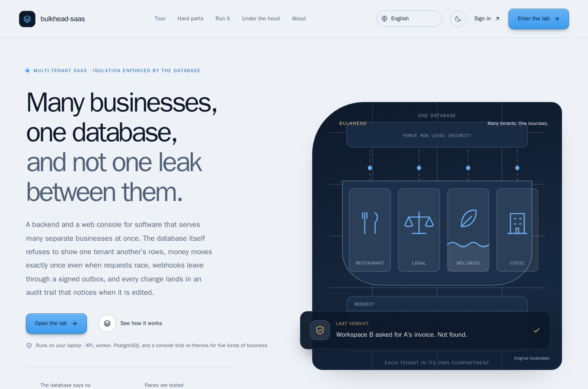
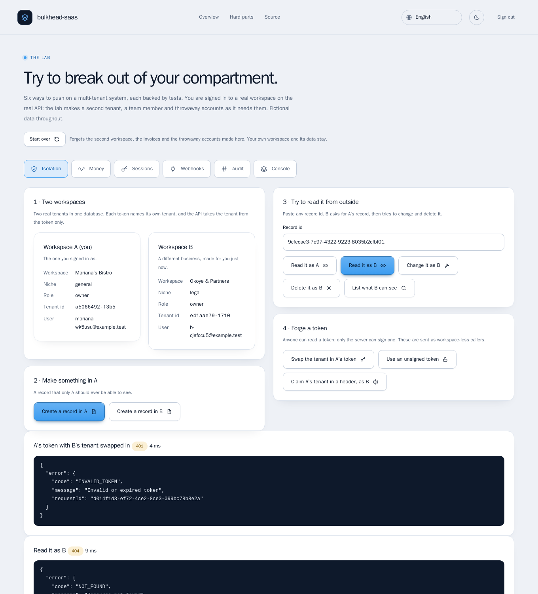
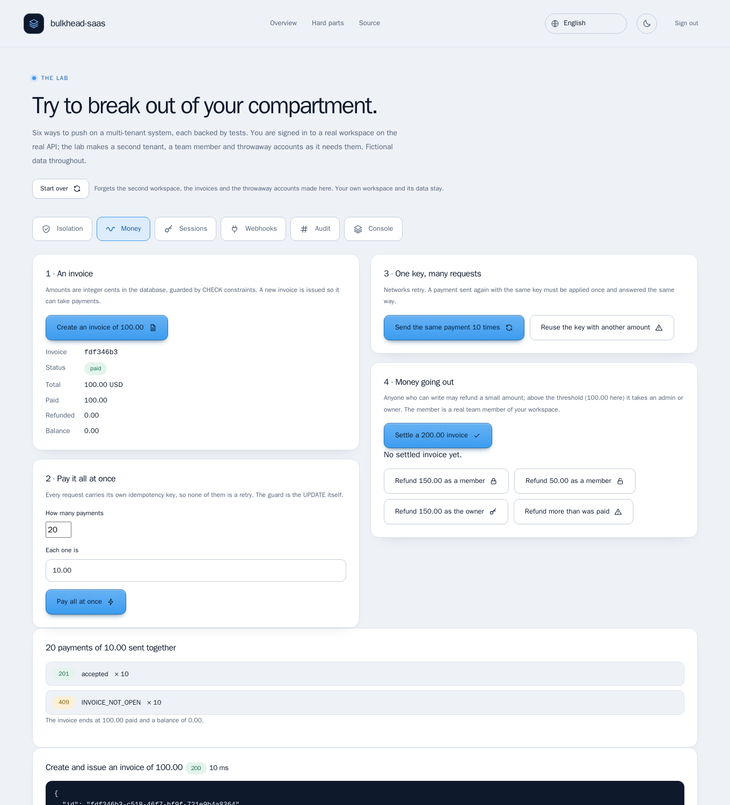
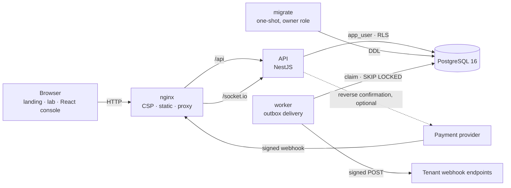
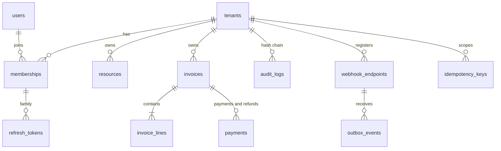

# bulkhead-saas

> **Many businesses, one database, and not one leak between them.** A multi-tenant SaaS backend and web console in which
> the **database itself refuses** to show one tenant another's rows, money moves **exactly once** even when requests race,
> webhooks leave through a **signed outbox**, and an audit trail **notices when it is edited**.

[](https://github.com/MenoDK/bulkhead-saas/actions/workflows/ci.yml)




The landing page and the sign-in are available in **14 languages** (English, 中文, हिन्दी, Español, Français, العربية, বাংলা, Português, Русский, اردو, Bahasa Indonesia, Deutsch, 日本語, 한국어), including right-to-left layouts: open `/?lang=ja` or use the selector in the header. The lab body, the decision records and this README stay in English; the translations were written for this project and a native review is welcome.

## Run it in a minute

You need **Docker** (Compose v2) and `make`. No API keys and no accounts anywhere else; nothing is sent off your machine.

```bash
git clone https://github.com/MenoDK/bulkhead-saas.git
cd bulkhead-saas
make up              # writes .env with fresh random secrets, builds, starts everything and waits until it is healthy
```

Open **http://localhost:8080**. The page explains the project and links to the **lab**, where every hard part below can be
tried in a browser. The first workspace you register is yours: sign-up is real, against the real API (it is limited to
20 sign-ups per address per window, like any public sign-up). The **console** a customer would use lives at
**http://localhost:8080/app/** and re-themes itself for five kinds of business. Stop with `make down` (keeps the data);
`make clean` deletes the volume. `make env` never overwrites an existing `.env`, so stopping and starting again is safe.



_Above: workspace B has the id of A's record and asks for it. The answer is the same `404` it would get for an id that never
existed, so nothing is confirmed. A token with another tenant swapped in is refused outright._

## What to try

Each row is a claim that is easy to make and hard to get right. The lab has a **Start over** button between attempts.

| Try to…                  | In the lab                                                                                                                       | You should see                                                                                                                                                                                                         |
| ------------------------ | -------------------------------------------------------------------------------------------------------------------------------- | ---------------------------------------------------------------------------------------------------------------------------------------------------------------------------------------------------------------------- |
| **Read their data**      | Isolation → _Create a record in A_ → _Read it as A_ / _Read it as B_ → _Swap the tenant in A's token_ → _Use an unsigned token_. | A reads it. B gets `404 NOT_FOUND`, identical to an id that never existed. The swapped and unsigned tokens are `401 INVALID_TOKEN`.                                                                                    |
| **Pay twice**            | Money → _Create an invoice of 100.00_ → _Send the same payment 10 times_ → _Reuse the key with another amount_.                  | One payment applied, nine replays marked `Idempotent-Replayed: true`. The same key with another body is `422 IDEMPOTENCY_KEY_REUSED`.                                                                                  |
| **Overspend**            | Money → _Create an invoice of 100.00_ → 20 payments of 10.00 → _Pay all at once_.                                                | Exactly ten `201` and ten `409 INVOICE_NOT_OPEN`; the invoice ends at 100.00 paid. The guard is inside the same `UPDATE` that records the payment, not in a check before it.                                           |
| **Refund too much**      | Money → _Settle a 200.00 invoice_ → _Refund 150.00 as a member_ → _Refund 50.00 as a member_ → _Refund 150.00 as the owner_.     | `403 REFUND_NEEDS_APPROVAL`, then allowed (under the threshold), then allowed (an owner). More than was paid is `422 EXCEEDS_PAID` for everyone.                                                                       |
| **Steal a session**      | Sessions → _Register a throwaway account_ → _Rotate_ → _Replay the old token_ → _Use the newest token_ → _Guess 12 passwords_.   | The replay is `401`, and so is the newest token: the whole family was revoked. Ten guesses answer `401`; from the eleventh it is `429 RATE_LIMITED`, even for the right password.                                      |
| **Aim a webhook inward** | Webhooks → _Try all the targets_ → _Register 203.0.113.7_ → _Create a record that fires an event_ → _Show deliveries_.           | Metadata address, `2130706433`, `0x7f.1`, `[::1]`, `localhost`, private addresses and credentials in the URL: all `400 UNSAFE_TARGET`. A documentation address is accepted and the separate worker records an attempt. |
| **Edit the history**     | Audit → _Verify_. Then, in a terminal, `scripts/tamper-demo.sh`.                                                                 | The update is refused by a trigger even for the schema owner. With the trigger switched off and a row edited, verification reports `valid: false` and the sequence number where the chain breaks.                      |



_Above: twenty simultaneous payments of 10.00 against a 100.00 invoice. Exactly ten succeed; the rest are refused because
the tenth closed the invoice._

Prefer the terminal? Everything is an HTTP API behind the same front door:

```bash
API=http://localhost:8080/api
register() { curl -s "$API/auth/register" -H 'content-type: application/json' \
  -d "{\"email\":\"$1\",\"password\":\"correct horse battery staple\",\"name\":\"$1\",\"tenantName\":\"$2\",\"niche\":\"general\"}"; }
token() { python3 -c 'import sys,json; print(json.load(sys.stdin)["accessToken"])'; }
A=$(register "a-$RANDOM@example.test" "Workspace A" | token)
B=$(register "b-$RANDOM@example.test" "Workspace B" | token)
ID=$(curl -s "$API/resources" -H "authorization: Bearer $A" -H 'content-type: application/json' \
  -H "Idempotency-Key: $(python3 -c 'import uuid;print(uuid.uuid4())')" -d '{"name":"only A may see this"}' \
  | python3 -c 'import sys,json; print(json.load(sys.stdin)["id"])')
curl -s -o /dev/null -w "A: %{http_code}\n" "$API/resources/$ID" -H "authorization: Bearer $A"   # 200
curl -s -o /dev/null -w "B: %{http_code}\n" "$API/resources/$ID" -H "authorization: Bearer $B"   # 404
```

### Run the checks

```bash
make check                      # lint, types, format, unit tests for the API and the web app
make e2e                        # API end-to-end against a real PostgreSQL (set TEST_DATABASE_URL)
make smoke                      # black-box check of the running stack (10 steps)
make up-e2e && make e2e-browser # Playwright + axe in a container, against the same stack: landing, lab, 14 languages, console
scripts/sabotage.sh             # breaks seven invariants on purpose; the matching test must go red
```

## What it is

Software that serves many separate customers from one system has one failure it cannot afford: letting one customer see or
damage another. The usual defence is a `where tenant_id = ?` that every query has to remember, and a query that forgets is a
breach. This project makes the **database** say no, then tests that it does, under concurrency, with a real PostgreSQL.

It is small on purpose (four tables of business data), but every part that matters in production is real: tenant isolation,
idempotent money, retries, SSRF, token theft, a tamper-evident audit trail, accessibility.

|                            Restaurant                            |                                   Legal                                    |                           Wellness (mobile)                            |
| :--------------------------------------------------------------: | :------------------------------------------------------------------------: | :--------------------------------------------------------------------: |
|  |  |  |

> Same application, same code: the workspace's **niche** picks the palette, radii, typeface and even the vocabulary ("Menu" / "Cases" / "Programs"). See [ADR 0008](docs/adr/0008-front-end-theming-and-delivery.md).

## What it demonstrates

| Capability                                                                  | Where                                         | How it is verified                                                                                                                                                            |
| --------------------------------------------------------------------------- | --------------------------------------------- | ----------------------------------------------------------------------------------------------------------------------------------------------------------------------------- |
| Tenant isolation in the database (RLS, `FORCE`, fail-closed, composite FKs) | `db/migrations`, `src/database`               | e2e: cross-tenant access answers 404, hand-written SQL as the runtime role sees nothing, no leak across a pooled connection                                                   |
| Object-level authorization (BOLA) and deny-by-default routes                | `src/common/guards.ts`, `resources/policy.ts` | e2e + a test that fails the build if any route lacks `@Roles` or `@Public`                                                                                                    |
| Hash-chained, append-only audit with signed export                          | `src/modules/audit`                           | unit (chain maths) + e2e (30 simultaneous writes still form one chain; an edit made behind the application is detected; the trigger blocks updates even for the schema owner) |
| Idempotent writes that commit with the work                                 | `src/modules/idempotency`                     | e2e: ten simultaneous requests with one key produce exactly one payment; the same key with a different body is refused                                                        |
| Money as integer minor units, guarded by constraints                        | `src/modules/billing`                         | unit (grammar, overflow) + e2e (20 parallel payments of 10.00 on a 100.00 invoice: exactly 10 succeed; refunds above a threshold need an admin)                               |
| Transactional outbox, leases, `SKIP LOCKED`, backoff, dead letters          | `src/modules/outbox`                          | e2e: two workers deliver each event exactly once; a flaky receiver is retried with backoff; a crashed worker's lease expires and the row is retried                           |
| Signed webhooks in and out, replay window, optional reverse confirmation    | `src/modules/webhooks`                        | e2e: modified body, rotated secret, ten simultaneous deliveries of one event applied once, and a notification is checked against what the provider says                       |
| SSRF guard (literal IPs, DNS re-check at delivery, no redirects)            | `src/modules/outbox/ssrf.ts`                  | unit + e2e; the literal-IP bypass was found by an adversarial test, see ADR 0004                                                                                              |
| Refresh-token rotation with reuse detection, timing-safe login, rate limits | `src/modules/identity`                        | e2e: replaying a rotated refresh token revokes the whole family; of many concurrent refreshes exactly one wins                                                                |
| Realtime isolation (Socket.IO rooms derived from the verified token)        | `src/modules/realtime`                        | e2e: events reach only the owning tenant, sockets without a valid token are refused, and a client cannot subscribe to another tenant's room                                   |
| Accessible, themeable UI with loading states                                | `web/`                                        | WCAG contrast test for every niche × mode (126 cases), axe scans in a real browser, keyboard-only sign-in                                                                     |
| A landing page and a lab that cannot lie                                    | `site/`, `scripts/record-transcripts.mjs`     | the transcripts shown on the page are recorded from the running stack, and `--check` fails CI when one stops matching; 14 languages, RTL, axe on the RTL and CJK pages        |

## Architecture



Only nginx publishes a port. It serves the landing page and the lab at `/`, the console at `/app/` ([ADR 0009](docs/adr/0009-landing-and-lab-at-the-root-console-under-app.md)), and proxies `/api` and `/socket.io`. The API connects as `app_user` (no ownership, no `BYPASSRLS`); schema changes run once, as the owner, in a separate `migrate` service so replicas never race on DDL.

### One request, end to end: "record a payment"

```mermaid
sequenceDiagram
  participant C as Client
  participant A as API
  participant D as PostgreSQL
  participant W as Worker
  C->>A: POST /invoices/:id/payments (Idempotency-Key)
  A->>A: verify JWT (HS256 pinned), role check
  A->>D: BEGIN; set_config('app.tenant_id', tid, true)
  A->>D: advisory lock on (tenant, key); replay if seen
  A->>D: SAVEPOINT; UPDATE invoice SET paid += x WHERE balance >= x
  A->>D: INSERT payment, audit entry (chained), outbox event
  A->>D: COMMIT
  A-->>C: 201 (Idempotent-Replayed: false)
  A--)C: socket.io "invoice.updated" (after commit)
  W->>D: claim due events (lease)
  W->>W: SSRF re-check, sign body
  W-->>W: POST to each endpoint, retry with backoff
```

### Data model



Tables with a `tenant_id` have row-level security (`resources`, `webhook_endpoints`, `idempotency_keys`, `invoices`, `invoice_lines`, `payments`, `audit_logs`). Child rows reference `(id, tenant_id)` so a child cannot point at another tenant's parent. `outbox_events`, `webhook_events`, `refresh_tokens` and `rate_limits` are intentionally cross-tenant system tables: they have no RLS, filter by tenant explicitly, and each has a test.

### Design decisions

Each has a record with the alternatives that were **rejected**:

| ADR                                                                    | Decision                                                |
| ---------------------------------------------------------------------- | ------------------------------------------------------- |
| [0001](docs/adr/0001-tenant-isolation-with-row-level-security.md)      | Isolation in the database (RLS), not only in code       |
| [0002](docs/adr/0002-hash-chained-audit-trail.md)                      | Per-tenant hash-chained, append-only audit              |
| [0003](docs/adr/0003-idempotency-keys-in-the-same-transaction.md)      | Idempotency keys commit with the work                   |
| [0004](docs/adr/0004-transactional-outbox.md)                          | Transactional outbox, not inline webhook calls          |
| [0005](docs/adr/0005-money-as-integer-minor-units.md)                  | Money as integer minor units guarded by `CHECK`s        |
| [0006](docs/adr/0006-session-model.md)                                 | Short access tokens, rotating refresh tokens            |
| [0007](docs/adr/0007-keyset-pagination.md)                             | Keyset pagination, not `OFFSET`                         |
| [0008](docs/adr/0008-front-end-theming-and-delivery.md)                | Tested theme tokens, same-origin delivery               |
| [0009](docs/adr/0009-landing-and-lab-at-the-root-console-under-app.md) | Landing page and lab at the root, console under `/app/` |

### The API

Authenticated routes need `Authorization: Bearer <access token>`; the tenant always comes from the token. Money-moving and creating calls require an `Idempotency-Key`.

| Route                                                                   | Who                                     | Notes                                              |
| ----------------------------------------------------------------------- | --------------------------------------- | -------------------------------------------------- |
| `POST /auth/register` · `login` · `refresh` · `logout` · `GET /auth/me` | public / any                            | rate limited per IP and per (e-mail, IP)           |
| `GET/POST /resources`, `GET/PATCH/DELETE /resources/:id`                | read any · write member+ · delete admin | optimistic concurrency via `version`, keyset pages |
| `GET/POST /invoices`, `GET /invoices/:id`                               | read any · write member+                | `POST` needs `Idempotency-Key`                     |
| `POST /invoices/:id/issue` · `void` · `payments` · `refunds`            | member+ (void: admin)                   | refunds above the threshold need admin             |
| `GET /audit` · `/audit/verify` · `/audit/export`                        | admin · admin · owner                   | export is HMAC-signed                              |
| `GET/POST/DELETE /webhook-endpoints`, `…/:id/ping`, `…/:id/deliveries`  | admin                                   | secret is returned once; targets are SSRF-checked  |
| `GET/POST/PATCH /members`                                               | read any · manage admin                 | the last owner cannot be removed                   |
| `POST /webhooks/payments`                                               | public, signed                          | HMAC + timestamp window + dedupe by event id       |
| `GET /health/live` · `/health/ready` · `/metrics`                       | public · public · token                 | Prometheus metrics                                 |

Events delivered to tenant endpoints: `resource.created|updated|deleted`, `invoice.issued`, `payment.received`, `refund.created`. Each request carries `X-Event-Id` (stable across retries), `X-Event-Topic` and `X-Signature: t=<unix>,v1=<hmac>`.

## Resources

Measured on this machine, not estimated.

| Service   | Image                      | Size   | Published | Notes                                                                                           |
| --------- | -------------------------- | ------ | --------- | ----------------------------------------------------------------------------------------------- |
| `db`      | `postgres:16-alpine`       | —      | no        | volume `pgdata`                                                                                 |
| `migrate` | API image                  | 290 MB | no        | one-shot, owner role, exits 0                                                                   |
| `api`     | `node:22-alpine`, non-root | 290 MB | no        | read-only root fs, all capabilities dropped                                                     |
| `worker`  | same image                 | —      | no        | `node dist/worker.js`; scale it independently                                                   |
| `web`     | nginx-unprivileged         | 79 MB  | `:8080`   | landing, lab and console; the console is ≈ 121 kB gzip JS and its admin screens are lazy-loaded |

Memory at idle, from `docker stats`: web 13 MiB, worker 34 MiB, api 48 MiB, db 27 MiB (about 122 MiB in total).

### Configuration

Validated at start-up (zod): a missing or malformed value stops the process with a readable message. Production additionally refuses `ALLOW_PRIVATE_WEBHOOK_TARGETS=true` and a scrypt cost below 2^14. See [`.env.example`](.env.example); `make env` fills it with fresh random secrets (mode 600, never committed).

## Testing

| Layer                  | Command                                       | What it covers                                                                                    |
| ---------------------- | --------------------------------------------- | ------------------------------------------------------------------------------------------------- |
| API unit               | `pnpm test`                                   | 127 tests of pure logic: money, hash chain, signatures, SSRF ranges, backoff, ciphers             |
| API end-to-end         | `TEST_DATABASE_URL=… pnpm test:e2e`           | 87 tests on a real Postgres: isolation, concurrency, outbox, webhooks, realtime                   |
| Web unit + integration | `cd web && pnpm test`                         | 209 tests: API client (single-flight refresh), money, theme tokens, pages with a fake API         |
| Browser end-to-end     | `make e2e-browser`                            | 80 tests (Playwright + axe, desktop and phone): landing, lab, all 14 languages, sign-up per niche |
| Recorded transcripts   | `node scripts/record-transcripts.mjs --check` | the answers printed on the landing page still match what the stack says                           |
| Tamper demo            | `scripts/tamper-demo.sh`                      | edits the audit trail behind the application; exits non-zero if the edit is **not** noticed       |
| Stack smoke            | `make smoke`                                  | the compose stack through nginx, including the separate worker process                            |
| Everything static      | `make check`                                  | lint, types, format, unit tests for API and web                                                   |

Every e2e spec runs on its own against a fresh database (a `globalSetup` migrates once).

**How the tests were checked for honesty.** A test that cannot fail proves nothing, so `scripts/sabotage.sh` breaks seven invariants one at a time and requires the matching spec to go red: the overpay guard in the payment `UPDATE`, the idempotency key lock, the audit-chain append lock, the refresh-token row lock, the SSRF literal-IP check, a route losing its `@Roles`, and the migrator no longer forbidding `BYPASSRLS` on the runtime role. It restores the source byte-for-byte and exits non-zero if any mutant survives; the last run killed 7 of 7. The first run did not: four mutants survived, and each turned out to be a weak test rather than a weak system. A `CHECK` constraint also answers 422, so asserting only the status hid the missing application guard (the spec now asserts the `EXCEEDS_BALANCE` code). Ten `Promise.all` requests do not reliably overlap inside Postgres, so the concurrency specs now hold a transaction open to force the overlap and check the outcome after it commits (without `FOR UPDATE` a second rotation from the same refresh token returns 200). The migrator re-asserts `NOBYPASSRLS` on every boot, which silently healed the original mutant; the mutant moved into the migrator and a spec checks the catalog. Front-end guards were sabotaged the same way: a low-contrast palette fails 3 contrast cases per colour, and the route-coverage test asserts it inspected more than 25 routes, so it cannot pass by finding nothing.

Running things for real found what reading code did not: the outbox worker exited immediately when run stand-alone (an unref'd timer and no HTTP server to keep Node alive); a webhook target with a non-existent host returned a 500 instead of a 400; `make env` overwrote an existing `.env`, so a second `make up` could no longer reach its own database (now a single idempotent recipe, with a CI step that runs it twice); and two sentences on the landing page described an answer the stack does not give (`422 EXCEEDS_BALANCE` where the race really ends in `409 INVOICE_NOT_OPEN`, and the point at which sign-in attempts start being refused: the eleventh) until the transcripts were recorded rather than written.

## Limitations

Being clear about these is part of the point.

- **The refresh token lives in `sessionStorage`.** A strict CSP is the mitigation, but an httpOnly cookie behind a backend-for-frontend is stronger and is the first thing I would change ([ADR 0006](docs/adr/0006-session-model.md)).
- **No e-mail verification, password reset or MFA.** Out of scope for a reference; the identity module is where they would plug in.
- **One audit head per tenant** serialises that tenant's audit writes. Fine at audit volumes; a hot tenant would need batching. A privileged attacker can still delete the whole tail: publishing the head hash externally would close that.
- **Socket.IO is single-node.** Scaling the API horizontally needs the Redis adapter (rooms already derive from the tenant, so it is a drop-in).
- **The rate limiter is database-backed.** Simple and correct; Redis would be cheaper at high request rates. While a limit is active even the right password is refused, by design (per account and per address).
- **Outbox latency is the poll interval** (1 s). `LISTEN/NOTIFY` would cut it.
- **Payments are modelled, not processed.** There is no real payment provider; the inbound webhook and reverse-confirmation paths are exercised against a stub.
- **Large tables.** `audit_logs` has a BRIN index on time and would be the first table to partition by tenant or month.
- **The translations of the landing page are machine-quality.** They were written for this project and have not been reviewed by native speakers.
- **Not load-tested.** Correctness under concurrency is tested; throughput is not claimed.

## Project layout

```
src/            NestJS modules: identity · tenancy · resources · billing · audit · idempotency · outbox · webhooks · realtime · observability
db/migrations/  plain SQL, checksummed, applied in order under an advisory lock
test/           end-to-end specs and the harness (real Postgres)
web/            React 19 + Vite + TypeScript console, Playwright tests, nginx config
site/           landing page, lab, shared kit and 13 language overlays (plain files, no build step)
docs/           map (00-READ-FIRST), checklist, handoff and the decision records in adr/
scripts/        smoke.sh, sabotage.sh (mutation proof), tamper-demo.sh, record-transcripts.mjs
.claude/        hooks, rules, skills and agent contracts for AI coding sessions
CLAUDE.md       entry point for an AI session (AGENTS.md holds the tool-neutral contract)
```

### Working with an AI coding session

The repository carries the documentation system a session needs to be cheap and controllable: a short `CLAUDE.md`, a
tool-neutral `AGENTS.md`, a docs **map** (`docs/00-READ-FIRST.md`) that says which document to open when, a handoff that
lets a fresh session resume from disk, and decision records with their rejected alternatives. It is checked by
[`docsguard`](https://github.com/MenoDK/docsguard) (`docsguard check`): the map must be complete, the ADRs
well formed, the handoff carry a measured suite state. Running that check on this repository's earlier records is what
found that all eight lacked a status line, three had no rejected-alternatives section and four no context;
they were restructured.
`.claude/settings.json` wires `docsguard`'s hooks (destructive git and writes to secrets or applied migrations are refused)
and does nothing when it is not installed.

## License

MIT
