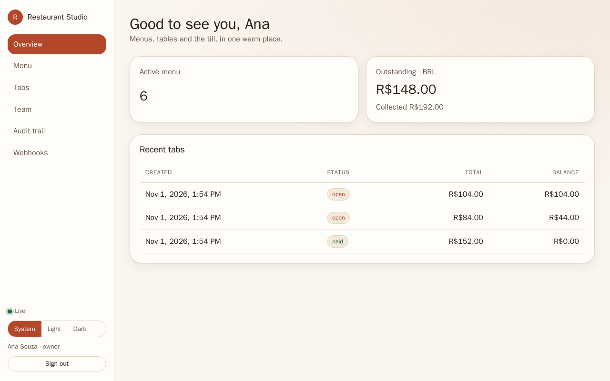
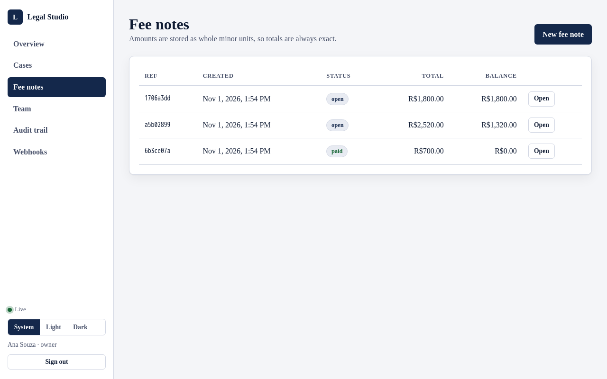
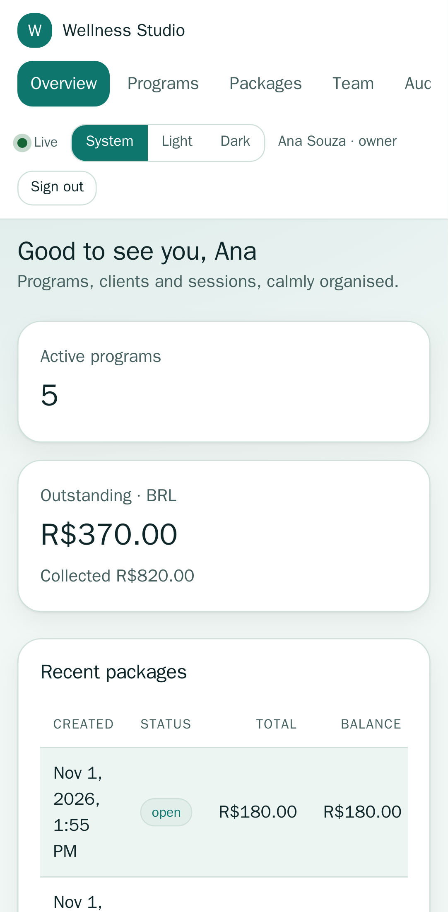
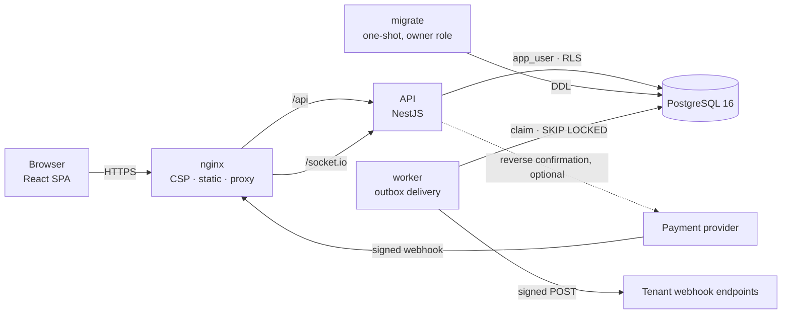
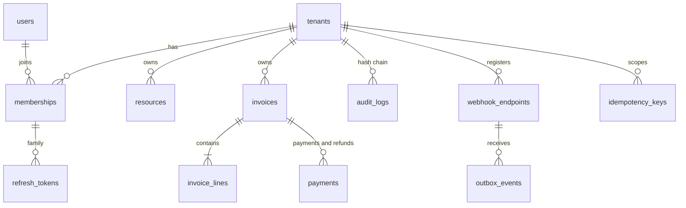

# Multitenant Platform

A reference implementation of a **multi-tenant SaaS backend and its web console**: NestJS 11 + PostgreSQL 16 with row-level security, a hash-chained audit trail, idempotent money movements, a transactional outbox for signed webhooks, realtime updates, and a React console that re-themes itself for five different kinds of business.

It is small on purpose (four tables of business data), but every part that matters in production is real and tested against a real database: tenant isolation, concurrency, retries, SSRF, token theft, accessibility.

|                            Restaurant                            |                                   Legal                                    |                           Wellness (mobile)                            |
| :--------------------------------------------------------------: | :------------------------------------------------------------------------: | :--------------------------------------------------------------------: |
|  |  |  |

> Same application, same code: the workspace's **niche** picks the palette, radii, typeface and even the vocabulary ("Menu" / "Cases" / "Programs"). See [ADR 0008](docs/adr/0008-front-end-theming-and-delivery.md).

## What it demonstrates

| Capability                                                                  | Where                                         | How it is verified                                                                                                                                                            |
| --------------------------------------------------------------------------- | --------------------------------------------- | ----------------------------------------------------------------------------------------------------------------------------------------------------------------------------- |
| Tenant isolation in the database (RLS, `FORCE`, fail-closed, composite FKs) | `db/migrations`, `src/database`               | e2e: cross-tenant access answers 404, hand-written SQL as the runtime role sees nothing, no leak across a pooled connection                                                   |
| Object-level authorization (BOLA) and deny-by-default routes                | `src/common/guards.ts`, `resources/policy.ts` | e2e + a test that fails the build if any route lacks `@Roles` or `@Public`                                                                                                    |
| Hash-chained, append-only audit with signed export                          | `src/modules/audit`                           | unit (chain maths) + e2e (30 simultaneous writes still form one chain; an edit made behind the application is detected; the trigger blocks updates even for the schema owner) |
| Idempotent writes that commit with the work                                 | `src/modules/idempotency`                     | e2e: ten simultaneous requests with one key produce exactly one payment; the same key with a different body is refused                                                        |
| Money as integer minor units, guarded by constraints                        | `src/modules/billing`                         | unit (grammar, overflow) + e2e (20 parallel payments of 10.00 on a 100.00 invoice: exactly 10 succeed; refunds above a threshold need an admin)                               |
| Transactional outbox, leases, `SKIP LOCKED`, backoff, dead letters          | `src/modules/outbox`                          | e2e: two workers deliver each event exactly once; a flaky receiver is retried with backoff; a crashed worker's lease expires and the row is retried                           |
| Signed webhooks in and out, replay window, optional reverse confirmation    | `src/modules/webhooks`                        | e2e: modified body, rotated secret, ten simultaneous deliveries of one event applied once, and a notification is checked against what the provider says                       |
| SSRF guard (literal IPs, DNS re-check at delivery, no redirects)            | `src/modules/outbox/ssrf.ts`                  | unit + e2e; the literal-IP bypass was found by an adversarial test, see ADR 0004                                                                                              |
| Refresh-token rotation with reuse detection, timing-safe login, rate limits | `src/modules/identity`                        | e2e: replaying a rotated refresh token revokes the whole family; of many concurrent refreshes exactly one wins                                                                |
| Realtime isolation (Socket.IO rooms derived from the verified token)        | `src/modules/realtime`                        | e2e: events reach only the owning tenant, sockets without a valid token are refused, and a client cannot subscribe to another tenant's room                                   |
| Accessible, themeable UI with loading states                                | `web/`                                        | WCAG contrast test for every niche × mode (126 cases), axe scans in a real browser, keyboard-only sign-in                                                                     |

## Architecture



Only nginx publishes a port. The API connects as `app_user` (no ownership, no `BYPASSRLS`); schema changes run once, as the owner, in a separate `migrate` service so replicas never race on DDL.

### One request, end to end: "record a payment"

```mermaid
sequenceDiagram
  participant C as Client
  participant A as API
  participant D as PostgreSQL
  participant W as Worker
  C->>A: POST /invoices/:id/payments (Idempotency-Key)
  A->>A: verify JWT (HS256 pinned), role check
  A->>D: BEGIN; set_config('app.tenant_id', tid, true)
  A->>D: advisory lock on (tenant, key); replay if seen
  A->>D: SAVEPOINT; UPDATE invoice SET paid += x WHERE balance >= x
  A->>D: INSERT payment, audit entry (chained), outbox event
  A->>D: COMMIT
  A-->>C: 201 (Idempotent-Replayed: false)
  A--)C: socket.io "invoice.updated" (after commit)
  W->>D: claim due events (lease)
  W->>W: SSRF re-check, sign body
  W-->>W: POST to each endpoint, retry with backoff
```

### Data model



Tables with a `tenant_id` have row-level security (`resources`, `webhook_endpoints`, `idempotency_keys`, `invoices`, `invoice_lines`, `payments`, `audit_logs`). Child rows reference `(id, tenant_id)` so a child cannot point at another tenant's parent. `outbox_events`, `webhook_events`, `refresh_tokens` and `rate_limits` are intentionally cross-tenant system tables: they have no RLS, filter by tenant explicitly, and each has a test.

## Quick start

Requires Docker with Compose v2 and `make` (Node 22 only if you want to run tests outside containers).

```bash
make up        # generates .env with random secrets, builds, starts, waits for health
open http://localhost:8080        # create a workspace, pick a niche
make smoke     # black-box check of the running stack (10 steps)
make down      # stop (keeps data);  make clean  deletes the volume
```

Without Docker, for development:

```bash
cp .env.example .env              # or: make env
docker run -d --name pg -e POSTGRES_PASSWORD=postgres -e POSTGRES_DB=app -p 5432:5432 postgres:16-alpine
pnpm install && pnpm start:dev            # API on :3000 (AUTO_MIGRATE applies the schema)
cd web && pnpm install && pnpm dev        # SPA on :5173, proxies /api and /socket.io
```

## Tests

| Layer                  | Command                             | What it covers                                                                                         |
| ---------------------- | ----------------------------------- | ------------------------------------------------------------------------------------------------------ |
| API unit               | `pnpm test`                         | pure logic: money, hash chain, signatures, SSRF ranges, backoff, ciphers                               |
| API end-to-end         | `TEST_DATABASE_URL=… pnpm test:e2e` | real Postgres: isolation, concurrency, outbox, webhooks, realtime                                      |
| Web unit + integration | `cd web && pnpm test`               | API client (single-flight refresh), money, theme tokens, pages with a fake API                         |
| Browser end-to-end     | `cd web && pnpm e2e`                | sign-up per niche, axe (WCAG 2.1 AA) on every screen in light and dark, no horizontal scroll on phones |
| Stack smoke            | `make smoke`                        | the compose stack through nginx, including the separate worker process                                 |
| Everything static      | `make check`                        | lint, types, format, unit tests for API and web                                                        |

Every e2e spec runs on its own against a fresh database (a `globalSetup` migrates once).

**How the tests were checked for honesty.** A test that cannot fail proves nothing, so `scripts/sabotage.sh` breaks seven invariants one at a time and requires the matching spec to go red: the overpay guard in the payment `UPDATE`, the idempotency key lock, the audit-chain append lock, the refresh-token row lock, the SSRF literal-IP check, a route losing its `@Roles`, and the migrator no longer forbidding `BYPASSRLS` on the runtime role. It restores the source byte-for-byte and exits non-zero if any mutant survives; the last run killed 7 of 7. The first run did not: four mutants survived, and each turned out to be a weak test rather than a weak system. A `CHECK` constraint also answers 422, so asserting only the status hid the missing application guard (the spec now asserts the `EXCEEDS_BALANCE` code). Ten `Promise.all` requests do not reliably overlap inside Postgres, so the concurrency specs now hold a transaction open to force the overlap and check the outcome after it commits (without `FOR UPDATE` a second rotation from the same refresh token returns 200). The migrator re-asserts `NOBYPASSRLS` on every boot, which silently healed the original mutant; the mutant moved into the migrator and a spec checks the catalog. Front-end guards were sabotaged the same way: a low-contrast palette fails 3 contrast cases per colour, and the route-coverage test asserts it inspected more than 25 routes, so it cannot pass by finding nothing. Two real defects were found by running things for real rather than by reading code: the outbox worker exited immediately when run stand-alone (an unref'd timer and no HTTP server to keep Node alive), and a webhook target with a non-existent host returned a 500 instead of a 400.

## Design decisions

Each has a record with the alternatives that were **rejected**:

| ADR                                                               | Decision                                          |
| ----------------------------------------------------------------- | ------------------------------------------------- |
| [0001](docs/adr/0001-tenant-isolation-with-row-level-security.md) | Isolation in the database (RLS), not only in code |
| [0002](docs/adr/0002-hash-chained-audit-trail.md)                 | Per-tenant hash-chained, append-only audit        |
| [0003](docs/adr/0003-idempotency-keys-in-the-same-transaction.md) | Idempotency keys commit with the work             |
| [0004](docs/adr/0004-transactional-outbox.md)                     | Transactional outbox, not inline webhook calls    |
| [0005](docs/adr/0005-money-as-integer-minor-units.md)             | Money as integer minor units guarded by `CHECK`s  |
| [0006](docs/adr/0006-session-model.md)                            | Short access tokens, rotating refresh tokens      |
| [0007](docs/adr/0007-keyset-pagination.md)                        | Keyset pagination, not `OFFSET`                   |
| [0008](docs/adr/0008-front-end-theming-and-delivery.md)           | Tested theme tokens, same-origin delivery         |

## API

Authenticated routes need `Authorization: Bearer <access token>`; the tenant always comes from the token. Money-moving and creating calls require an `Idempotency-Key`.

| Route                                                                   | Who                                     | Notes                                              |
| ----------------------------------------------------------------------- | --------------------------------------- | -------------------------------------------------- |
| `POST /auth/register` · `login` · `refresh` · `logout` · `GET /auth/me` | public / any                            | rate limited per IP and per (e-mail, IP)           |
| `GET/POST /resources`, `GET/PATCH/DELETE /resources/:id`                | read any · write member+ · delete admin | optimistic concurrency via `version`, keyset pages |
| `GET/POST /invoices`, `GET /invoices/:id`                               | read any · write member+                | `POST` needs `Idempotency-Key`                     |
| `POST /invoices/:id/issue` · `void` · `payments` · `refunds`            | member+ (void: admin)                   | refunds above the threshold need admin             |
| `GET /audit` · `/audit/verify` · `/audit/export`                        | admin · admin · owner                   | export is HMAC-signed                              |
| `GET/POST/DELETE /webhook-endpoints`, `…/:id/ping`, `…/:id/deliveries`  | admin                                   | secret is returned once; targets are SSRF-checked  |
| `GET/POST/PATCH /members`                                               | read any · manage admin                 | the last owner cannot be removed                   |
| `POST /webhooks/payments`                                               | public, signed                          | HMAC + timestamp window + dedupe by event id       |
| `GET /health/live` · `/health/ready` · `/metrics`                       | public · public · token                 | Prometheus metrics                                 |

Events delivered to tenant endpoints: `resource.created|updated|deleted`, `invoice.issued`, `payment.received`, `refund.created`. Each request carries `X-Event-Id` (stable across retries), `X-Event-Topic` and `X-Signature: t=<unix>,v1=<hmac>`.

## Runtime footprint

Measured on this machine, not estimated.

| Service   | Image                      | Size   | Published | Notes                                               |
| --------- | -------------------------- | ------ | --------- | --------------------------------------------------- |
| `db`      | `postgres:16-alpine`       | —      | no        | volume `pgdata`                                     |
| `migrate` | API image                  | 290 MB | no        | one-shot, owner role, exits 0                       |
| `api`     | `node:22-alpine`, non-root | 290 MB | no        | read-only root fs, all capabilities dropped         |
| `worker`  | same image                 | —      | no        | `node dist/worker.js`; scale it independently       |
| `web`     | nginx-unprivileged         | 78 MB  | `:8080`   | SPA ≈ 121 kB gzip JS; admin screens are lazy-loaded |

## Configuration

Validated at start-up (zod): a missing or malformed value stops the process with a readable message. Production additionally refuses `ALLOW_PRIVATE_WEBHOOK_TARGETS=true` and a scrypt cost below 2^14. See [`.env.example`](.env.example); `make env` fills it with fresh random secrets (mode 600, never committed).

## Limitations and what I would do next

Being clear about these is part of the point.

- **The refresh token lives in `sessionStorage`.** A strict CSP is the mitigation, but an httpOnly cookie behind a backend-for-frontend is stronger and is the first thing I would change ([ADR 0006](docs/adr/0006-session-model.md)).
- **No e-mail verification, password reset or MFA.** Out of scope for a reference; the identity module is where they would plug in.
- **One audit head per tenant** serialises that tenant's audit writes. Fine at audit volumes; a hot tenant would need batching. A privileged attacker can still delete the whole tail: publishing the head hash externally would close that.
- **Socket.IO is single-node.** Scaling the API horizontally needs the Redis adapter (rooms already derive from the tenant, so it is a drop-in).
- **The rate limiter is database-backed.** Simple and correct; Redis would be cheaper at high request rates.
- **Outbox latency is the poll interval** (1 s). `LISTEN/NOTIFY` would cut it.
- **Payments are modelled, not processed.** There is no real payment provider; the inbound webhook and reverse-confirmation paths are exercised against a stub.
- **Large tables.** `audit_logs` has a BRIN index on time and would be the first table to partition by tenant or month.
- **CI is written but I have not run it on GitHub** from here. Everything it runs was run locally: lint, types, unit, e2e, web tests, browser tests, and the compose smoke test.

## Layout

```
src/            NestJS modules: identity · tenancy · resources · billing · audit · idempotency · outbox · webhooks · realtime · observability
db/migrations/  plain SQL, checksummed, applied in order under an advisory lock
test/           end-to-end specs and the harness (real Postgres)
web/            React 19 + Vite + TypeScript SPA, Playwright tests, nginx config
docs/            map (00-READ-FIRST), checklist, handoff and the decision records in adr/
scripts/        smoke.sh, sabotage.sh (mutation proof of the critical invariants)
.claude/        hooks, rules, skills and agent contracts for AI coding sessions
CLAUDE.md       entry point for an AI session (AGENTS.md holds the tool-neutral contract)
```

## Working with an AI coding session

The repository carries the documentation system a session needs to be cheap and controllable: a short `CLAUDE.md`, a
tool-neutral `AGENTS.md`, a docs **map** (`docs/00-READ-FIRST.md`) that says which document to open when, a handoff that
lets a fresh session resume from disk, and decision records with their rejected alternatives. It is checked by
[`docsguard`](https://github.com/MenoDK/docsguard) (`docsguard check`): the map must be complete, the ADRs
well formed, the handoff carry a measured suite state. Running that check on this repository's earlier records is what
found that all eight lacked a status line, three had no rejected-alternatives section and four no context;
they were restructured.
`.claude/settings.json` wires `docsguard`'s hooks (destructive git and writes to secrets or applied migrations are refused)
and does nothing when it is not installed.

## License

MIT
